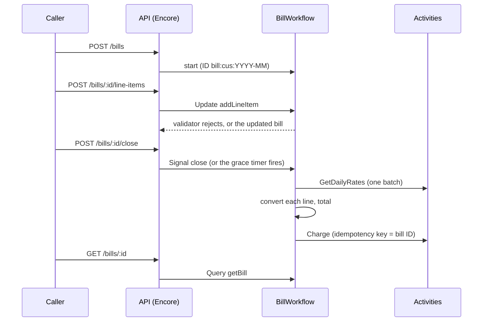

# fees-service

A fees API built on [Encore](https://encore.dev) and [Temporal](https://temporal.io). Each customer's monthly bill is
one Temporal workflow: it opens for a month, accrues line items as fees happen, and on close converts every line into
the bill's currency, totals it and charges the customer. Temporal is the store of state — there is no bills table.

- [Running locally](#running-locally)
- [Walkthrough](#walkthrough)
- [API](#api)
- [Design](#design)
- [Assumptions](#assumptions)
- [What production would add](#what-production-would-add)
- [Layout](#layout)

## Running locally

Prerequisites: Go 1.27, Docker, and the Encore CLI (`brew install encoredev/tap/encore`, or
`curl -L https://encore.dev/install.sh | bash` on Linux).

```sh
make up      # Temporal dev server on :7233, UI on http://localhost:8233
make run     # API + worker on http://localhost:4000, Encore dashboard on http://localhost:9400
make test
make lint    # golangci-lint v2.15+
```

The spec suggests Temporalite; it has been archived and folded into the Temporal CLI's `temporal server start-dev`,
which `make up` runs in Docker. It registers the bill search attributes and sets the namespace's retention to 365
days, so completed bills stay queryable. Set `TEMPORAL_ADDRESS` to point the app elsewhere.

## Walkthrough

```sh
API=http://localhost:4000
BILL='bill:cus_42:2026-11'   # use the current month

# Open November's bill, charged in GEL.
curl -X POST $API/bills -d '{"customerId":"cus_42","period":"2026-11","currency":"GEL"}'   # 201

# Accrue fees, in either currency. occurredAt picks the day's exchange rate.
curl -X POST "$API/bills/$BILL/line-items" \
  -d '{"id":"li_1","description":"Card issuance","amount":"10.00","currency":"GEL"}'
curl -X POST "$API/bills/$BILL/line-items" \
  -d '{"id":"li_2","description":"Wire fee","amount":"5","currency":"USD","occurredAt":"2026-11-03T10:00:00Z"}'

# Retrying li_2 is a no-op (200); reusing its ID for a different fee is a conflict (409).
curl -X POST "$API/bills/$BILL/line-items" \
  -d '{"id":"li_2","description":"Wire fee","amount":"6","currency":"USD"}'                # 409

# Close. Conversion and charging run asynchronously.
curl -X POST "$API/bills/$BILL/close"                                                       # 202
curl "$API/bills/$BILL"
# status CHARGED, total 23.50 GEL: 10.00 GEL + 5.00 USD × 2.70 = 13.50 GEL, each line showing its rate and date

# The bill no longer takes fees.
curl -X POST "$API/bills/$BILL/line-items" \
  -d '{"id":"li_3","description":"Late fee","amount":"1","currency":"GEL"}'                # 400

curl "$API/bills?customerId=cus_42&status=CHARGED"
```

A customer ID starting with `cus_decline` makes the stub payment provider decline, ending the bill in
`CHARGE_FAILED`. Each bill's full event history is in the Temporal UI.

## API

All amounts are decimal strings (`"12.50"`), never JSON numbers.

| Endpoint | Does | Success | Errors |
|---|---|---|---|
| `POST /bills` | Open a bill: `customerId`, `period` (`YYYY-MM`, UTC), `currency` | `201`; an identical retry `200` | `400` invalid input or a past month; `409` the bill exists in another currency or has finished |
| `POST /bills/:id/line-items` | Add a fee: `id`, `description`, `amount`, `currency`, optional `occurredAt` | `200` with the bill | `400` invalid, or bill not open; `409` `id` reused with different details; `404` |
| `POST /bills/:id/close` | Ask the bill to close | `202` with the bill as it stands | `404` |
| `GET /bills/:id` | The bill, its lines, subtotals per currency and, once closed, conversions and total | `200` | `404` |
| `GET /bills` | Summaries; optional `customerId`, `status`, `period`, `currency`, `pageSize` (≤ 100), `pageToken` | `200` | `400` invalid filter |

A bill's ID is `bill:{customerId}:{period}`. Its status runs `OPEN → CLOSING → CHARGING → CHARGED | CHARGE_FAILED`;
line items are accepted only while `OPEN`.

## Design



**One workflow per customer per month.** The workflow ID is the bill ID, so Temporal's uniqueness of running IDs —
plus a reject-duplicate reuse policy — guarantees one bill per customer per month and makes create idempotent with
no extra lookup.

**Update to add, Signal to close, Query to read.** The spec asks for signals, but a signal cannot answer: the caller
only learns it was delivered, so "reject a line item on a closed bill" would be silent or racy (query, then signal,
with a close landing in between). An Update runs a validator inside the workflow and answers synchronously, so the
rejection is a real `400`/`409` and a rejected update never enters history. Close needs no answer and must not be
lost, so it is a signal; closing twice is harmless.

**Closing.** The caller decides when a month's usage is complete, so the close signal is the normal path; a bill can
also close early. A timer at period end plus a grace period (7 days by default) closes a bill the caller forgot, so
no workflow stays open forever. A timer at exactly period end would race with late-arriving usage.

**Money is `int64` minor units with an ISO 4217 code** — exact, fast to add and compare, and ±9.2×10¹⁶ cents of
range, far beyond any fee. Float is wrong (0.1 + 0.2 ≠ 0.3), a big integer buys nothing at this range, and a
string inside the domain would be parsed on every operation. On the wire amounts are decimal strings: readable,
independent of the currency's minor unit, and safe from JavaScript turning JSON numbers into floats. Each currency's
exponent comes from a table, so a 0- or 3-decimal currency is one entry; parsing rejects extra precision rather than
rounding it away. Exchange-rate maths uses `shopspring/decimal` and rounds half to even.

**Currencies.** "Handle GEL and USD" could mean a bill per currency, per-currency totals, or conversion. A bill has a
base currency it is charged in, and line items may be in either currency, so a customer gets one bill and one charge
a month. Conversion uses each line's own day's rate — not the rate on the day the bill closes, which over a month
could move enough to over- or under-charge — but the rates are fetched once, in a single activity, at close. A
published daily rate does not change, so fetching late gives the same number while keeping the exchange-rate service
off the path of capturing a fee. Each line is rounded on its own and the total is the sum of the lines, so the
statement always adds up. The rates are recorded in history, so a replay converts identically.

**Idempotency.** Line item IDs are the caller's idempotency keys: a retry with the same payload returns the bill
unchanged — even after the bill has closed, so a retry gets the answer the original got — and the same ID with
different details is a conflict. The bill ID is the payment idempotency key, so a charge retried after a lost
acknowledgement does not charge twice.

**Failure.** The charge retries five times with backoff; a decline is not retried. Either way the workflow completes
successfully with the bill in `CHARGE_FAILED`, so the final bill stays readable as its result rather than being
buried in a failed workflow. The exchange-rate lookup retries indefinitely, since a rate will exist.

**Long bills** continue as new when Temporal suggests it, carrying the bill, so a customer with thousands of fees a
month never hits the history limit.

**Listing** reads visibility (search attributes `CustomerID`, `BillStatus`, `BillPeriod`, `BillCurrency`,
`BillTotal`), so a page of summaries costs one call rather than one query per bill. It is eventually consistent: a
bill created a moment ago may take a second to appear. Filters are validated against closed formats before they
reach the visibility query.

## Assumptions

- Callers are trusted internal services, so the endpoints are unauthenticated; customers never call this API.
- A period is a UTC calendar month. Only the current or a future month can be opened.
- Fees are positive. Credits and refunds would be a separate line type.
- The FX and payment providers are stubs: a fixed USD/GEL rate of 2.70 for every date, and a provider that accepts
  every charge except for `cus_decline*` customers.
- The Temporal worker runs inside the API process.

## What production would add

- **Durable invoices.** Retention eventually deletes completed workflows, so a closed bill would be written to a
  ledger or database by a final activity; Temporal then holds only bills in flight.
- **A separate worker deployment**, so API and worker scale and deploy independently. The workflow package has no
  Encore dependency, so it moves to its own binary unchanged.
- **Versioning.** A bill runs for a month, so changing its logic needs `workflow.GetVersion` or worker versioning, and
  replay tests against recorded histories.
- **Real providers** behind `fx.Service` (the National Bank of Georgia publishes an official daily GEL rate) and
  `payment.Service`, plus dunning for `CHARGE_FAILED` bills.
- **Service authentication** (mTLS or Encore auth handlers) and per-customer billing currency from the customer
  service rather than the request.
- **Waiting on close.** `POST /close` could wait a few seconds for the total and fall back to `202`.

## Layout

```
internal/api/bill/               Encore service: endpoints, error mapping, Temporal client and worker
internal/services/bill/workflow/ BillWorkflow, activities, line-item validation, close-time conversion
internal/services/fx/            exchange-rate service interface + fixed-rate stub
internal/services/payment/       payment service interface + stub
internal/models/domain/          Bill, LineItem, Conversion — the state Temporal stores
internal/models/api/             HTTP request and response types
internal/adapters/               domain ↔ API mapping
internal/money/                  Money, parsing, formatting, conversion
```

[AGENTS.md](AGENTS.md) records the conventions and invariants in more detail.
